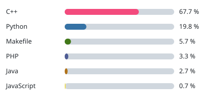

# Sébastien Merlière Vanhoeke

**Développeur C++ embarqué (Linux) · Java / Vaadin · Android natif**
7 ans d'expérience · Freelance en télétravail

---

## Ce que je fais

- **C++ embarqué sous Linux** : logiciels pour systèmes embarqués, du bas niveau à l'application.
- **Java / Vaadin** : interfaces web métier et back-offices (gestion de stock, outils internes).
- **Android natif** : applications publiées sur Google Play.

## Stack

Également : Spring, PHP / MySQL, shell, Raspberry Pi et Bluetooth Low Energy.

## Projets

- **[Install-rtl8821ce-driver](https://github.com/sergeibux/Install-rtl8821ce-driver)** : installation du pilote Wi-Fi RTL8821CE sous Linux.
- **NSA-app** : application Android de gestion de stock, avec son site web et ses outils de synchronisation. Publiée sur Google Play.

Langages les plus utilisés (à décommenter une fois le workflow GitHub Action en place) :

## Me contacter

- LinkedIn : [Sébastien Merlière Vanhoeke](https://fr.linkedin.com/in/sebastienmerlierevanhoeke-developpeur)
- Malt : [mon profil](https://www.malt.fr/profile/sebastienmerlierevanhoekedeveloppeur)

Missions en télétravail uniquement.
